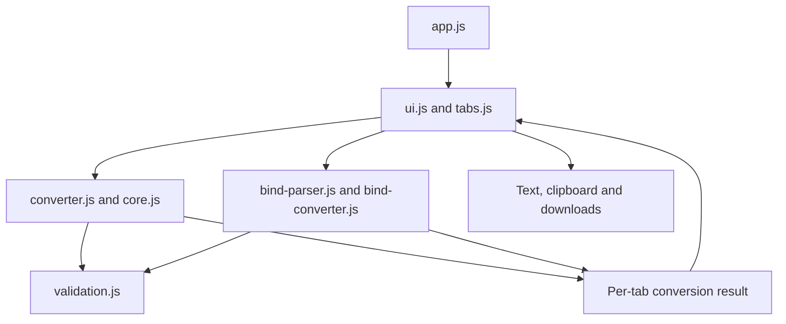

# Architecture — DNS Record Converter

> Updated 30 October 2026. Source package `0.2.0-alpha.1`, unreleased and untagged.
> Historical GitHub baseline: [`94a8385`](https://github.com/safesploitOrg/bind9-zone-generator/commit/94a83854a5f55997a75726cabd46db4e6c2c96b6).

## 1. Purpose and operating model

The application converts hosts-style inventory into BIND9 zones, and BIND forward-zone text into IPv4 hosts-file mappings. Both directions run locally in a static page. It has no backend, database, runtime dependencies, build transform, remote conversion API or automatic DNS/hosts installation.

The default tab retains **dnsmasq hosts.d → BIND9 Zone Generator**. The second tab is **BIND → /etc/hosts**. Each has independent settings, input, output, validation and export state. Profiles B + D apply under SFW v1.1.0; this parser-sensitive change is T2 and has not been publicly released.

## 2. Modules and dependencies

| Module/path | Responsibility |
| --- | --- |
| `public/index.html` | Tab/panel semantics, labelled controls, output and status containers, local assets and meta CSP. |
| `public/assets/css/styles.css` | Responsive layout, explicit hidden states, keyboard focus and output scrolling. |
| `public/assets/js/app.js` | `main()` creates and binds the browser adapters. |
| `ui.js` | Reads inputs, owns per-tab result/stale state, renders text, handles failures and clipboard/download I/O. |
| `tabs.js` | ARIA selected state, roving tabindex, hidden panels and arrow/Home/End navigation. |
| `validation.js` | Shared `ConversionError`, input/work limits, DNS naming, IPv4/network/TTL/serial rules and output bounds. |
| `core.js` | Hosts parser, complete primary/alias model and forward/reverse serialisation. |
| `converter.js` | Validates settings, coordinates hosts conversion, captures outputs/config/serial and selects export metadata. |
| `bind-parser.js` | Bounded logical-record lexer and separate BIND parsing grammar. |
| `bind-converter.js` | Offline CNAME resolution, deterministic grouping and name-format selection. |
| `examples.js` | Self-contained examples; no external assets/data. |
| `public/assets/images/favicon.svg` | Local vector favicon. |
| `tests/unit/`, `tests/fixtures/` | Current regressions/reference data and clearly labelled historical fixtures. |
| `scripts/`, `.semgrep.yml` | Source checks, independent BIND checks, targeted scanner and optional local browser matrix. |
| `.github/workflows/static.yml` | Validation-gated Pages delivery; browser CI remains disabled by owner direction. |

Only `public/` is deployed. Node/npm are verification tooling, not browser requirements. Static ES modules require HTTP/HTTPS serving. Relative paths support GitHub Pages project URLs.

## 3. Data flow and state

The hosts path validates configuration, parses rows, canonicalises names, builds a complete A-owner index, checks aliases, chooses one serial and renders forward/reverse text. The BIND path first tokenises logical records, then parses context and supported mappings, validates conflicts, resolves bounded alias chains and groups hostnames by numeric-sorted address.

Pure conversion code does not read the DOM or perform I/O. `createApp()` receives document, clipboard, URL, Blob and clock adapters. The browser supplies native APIs; unit tests supply focused adapters rather than pretending to be a full browser.

Hosts results contain copied validated configuration, a serial, accepted-row count, warnings, forward/reverse text and reverse-zone name. BIND results contain origin/name style, source/A-record counts, hosts-line count, warnings and hosts text. Errors are `ConversionError` instances with stable codes and bounded diagnostic messages/line context.

The UI owns one result and stale flag for each direction. A successful run enables only that direction's exports. Edits mark it stale and disable export; a failed run clears that tab's old output. Export filenames/content come from the same captured result. Switching tabs does not regenerate or discard results.

No cookies, local/session storage, IndexedDB or service worker are used. State exists only in page memory. Successful hosts generation updates the visible previous-serial field so a following run increments it; reloads do not preserve installed DNS state. Clipboard/downloads are deliberate external copies.

## 4. Hosts → BIND contracts

Rows are IPv4 plus primary/alias names, with whitespace and `#`/`;` comments. Valid non-matching addresses are filtered; malformed rows and invalid names/settings block the conversion. Leading-zero address components are normalised as decimal. Empty or oversized results cannot be exported.

Supported networks are octet prefixes and aligned `/8`, `/16`, `/24` CIDR. The reverse descriptor owns both the zone and remaining-octet count: `172.16.` produces zone `16.172.in-addr.arpa` and address `172.16.5.10` produces owner `10.5`.

Names are lowercased validated ASCII hostnames. Explicit terminal dots are absolute; bare in-domain FQDNs are recognised as a hosts-input convenience; other names, including dotted-relative ones, gain the selected domain. Forward/PTR/header naming shares those rules. Explicitly out-of-zone owners are rejected.

Primary A records are indexed before aliases are checked, preventing input-order CNAME/A conflicts. Aliases cannot have different targets, occupy the zone apex or name the authoritative server. Multiple addresses on an A owner are supported. PTR keeps the first primary per address, with a notice if another primary exists.

Full forward output includes an explicit origin, TTL, SOA and NS; an in-zone NS must have an A record in selected input. Include output has absolute names and per-record TTLs. Reverse output is always a complete zone. Supported files are independently checked by BIND in integration tests.

A supplied previous serial increments modulo 2³²; otherwise a UTC `YYYYMMDD00` seed is used. One serial is shared by the two outputs. This handles successive runs and supplied installed state, not automatic installed-state discovery.

## 5. BIND → hosts contracts

The lexer tracks quotes, escapes, comments and parentheses before recognising logical records. It preserves leading-whitespace owner inheritance and source lines. The parser handles `$ORIGIN`, `$TTL`, TTL/class ordering and subdomain origins without interpreting record-looking strings inside quoted RDATA.

BIND names use strict master-file origin rules; the hosts-input FQDN convenience does not apply. An initial origin supplies fragment context, the first directive may establish it, and subsequent origins stay within one selected zone. Explicit absolute records need no origin unless short-only display is requested.

IPv4 `IN A` and `IN CNAME` mappings are supported. Other common types/classes, wildcard owners and out-of-zone supported owners produce notices and are omitted. Unsupported RDATA is not fully validated. File includes, generated records, unsupported directives, malformed supported data, alias conflicts/loops and excessive work block output.

CNAME resolution uses only pasted A data and a bounded iterative chain/cache model. Missing/external targets produce notices; no lookup or invented address occurs. Multi-address targets expand their alias onto each address. CNAME owners cannot overlap incompatible data or the zone apex.

Output contains one numeric-sorted IP line. A-owner names sort before CNAME aliases, determining a stable canonical name. FQDN-only, origin-relative-only and both formats are available; terminal dots are removed. Apex names remain the domain, never `@`. TTLs and DNS-only semantics are deliberately lost.

The complete grammar/limit contract is in [docs/format-contract.md](docs/format-contract.md).

## 6. Resource and trust boundaries

| Boundary | Control | Residual consideration |
| --- | --- | --- |
| Pasted input → parser | 1 MB/20,000-line limit; 10,000 records/names; bounded tokens/logical records; strict supported syntax. | A synchronous parser can still take time on slow devices; no universal latency guarantee. |
| Alias data → grouping | 32-hop depth, 200,000 work/expansion operations, 256 names per IP. | Hosts output cannot reproduce DNS resolver ordering or dynamic round-robin behaviour. |
| Data → screen | `textContent`, element creation and `replaceChildren`; no HTML insertion or inline handlers. | Real-browser/a11y execution is not verified here. |
| Page → external systems | No fetch/storage/third-party code; meta CSP blocks connections/forms/objects/base URLs and permits local assets. | Hosting logs, extensions and response headers are outside this source assessment; CSP needs browser verification. |
| Output → files | 2 MB per-output limit, captured metadata, disabled stale/error exports, cleanup and failure feedback. | User copies may contain private inventory and require manual review/retention. |
| Source → hosting | SHA-pinned actions, restricted deployment permissions and validation dependencies. | Hosted required checks/environment protection remain unverified; no deployment occurred. |

There is no backend authentication, session, database or privileged network boundary. No DNS/hosts installation is performed. See [SECURITY.md](SECURITY.md) and [docs/threat-model.md](docs/threat-model.md).

## 7. Tests and delivery

`npm run check` runs focused source checks and Node tests. Current tests cover correctness regressions that failed before fixes, parser syntax and limits, deterministic malformed inputs, alias resolution, reference mappings, UI error/export behaviour and tabs. Legacy fixtures remain unchanged historical evidence, not desired current outputs.

`npm run test:bind` independently validates `/8`, `/16`, `/24`, complete/include-parent zones, negative invalid zones, and agreement between importer results from an original fixture and BIND canonicalisation. Targeted Semgrep checks fail on configured findings or scanner/report errors, verify all production JS files were scanned, and test scanner failure with synthetic findings.

The optional local browser script covers three engines × three viewports, keyboard tabs, actual downloads, denied clipboard access, labels, stale/error recovery, reduced motion and zoom. Its execution is blocked by unavailable browser binaries here. Playwright CI remains explicitly disabled under [EX-001](docs/engineering/EXCEPTIONS.md).

The workflow validates PRs/main/manual events, then deploys on `main` only after source/unit, security and BIND jobs pass. It checks out the event commit in each job and publishes `public/` without a build transform. Only deployment receives Pages/OIDC write permissions. No hosted run or protection setting is claimed by this package.

## 8. Change and recovery

All functional roadmap stages are implemented; see [ROADMAP.md](ROADMAP.md). [docs/verification.md](docs/verification.md) separates executed checks from release gaps. Update this document and tests when grammar, naming, limits, state, formats or gates change.

This source remains unreleased. Reverting/redeploying the app requires a separate authorised action; already installed DNS/hosts files have independent state and need their own backup/change process. No owner release approval or blanket security exception is recorded by implementation alone.
