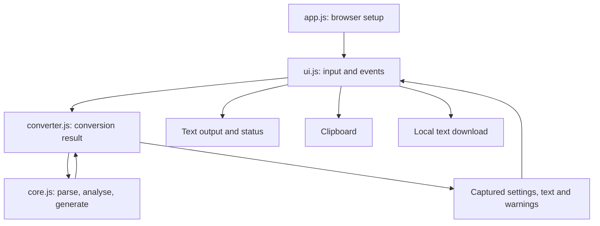

# Architecture — BIND9 Zone Generator

> Updated: 30 October 2026. Prepared version: `0.1.0-alpha.1` (unreleased).
> Baseline: [`94a83854a5f55997a75726cabd46db4e6c2c96b6`](https://github.com/safesploitOrg/bind9-zone-generator/commit/94a83854a5f55997a75726cabd46db4e6c2c96b6).
> Current state below describes the source in this package; it has not been pushed or deployed.

## 1. Purpose and scope

Convert pasted dnsmasq/hosts-style text into BIND9 A/CNAME forward records and PTR reverse records. The user generates, reviews and exports text; installation and independent DNS validation remain separate operator tasks.

The application is browser-only and static. It has no backend, database, runtime library dependencies, network conversion API, storage layer or build step. The public directory is published directly. Profiles B + D apply under the supplied SFW standard. The foundation refactor is reviewed conservatively as T2 because untrusted parsing code and delivery gates are involved, despite preserving the conversion grammar.

This stage extracts the original single-file implementation, adds maintained tests and CI checks, and fixes export-state handling. It does not implement tabs, a BIND parser or `/etc/hosts` output.

## 2. Source organisation

| Path | Responsibility |
| --- | --- |
| `public/index.html` | Semantic controls and output containers, with external stylesheet/module/favicon references. |
| `public/assets/css/styles.css` | Original dark theme and responsive layout; disabled-export and status styles. |
| `public/assets/js/core.js` | Pure IPv4 parsing, name analysis, forward/reverse serialisation and header helpers. |
| `public/assets/js/converter.js` | Calls core functions and captures output, settings, warnings and export metadata. |
| `public/assets/js/ui.js` | DOM/event adapters, rendering, clipboard, downloads and stale-input feedback. |
| `public/assets/js/app.js` | `main()` creates and binds the browser UI. |
| `public/assets/images/favicon.svg` | Code-native network favicon, with no remote image dependency. |
| `tests/unit/` | Node tests for core, converter and UI adapters. |
| `tests/fixtures/legacy/` | Nine original-output cases, with input/config/clock/source-commit provenance. |
| `scripts/` | Focused source checks, independent BIND validation and targeted security scanner wrapper. |
| `.semgrep.yml` | Local SAST/credential patterns. |
| `.github/workflows/static.yml` | Source/unit, security and BIND jobs, followed by gated Pages deployment. |
| `docs/engineering/` | Canonical SFW v1.1.0 policy and the owner-directed Playwright exception. |

Only `public/` is deployed. Tests, policy, package metadata and documentation stay outside the publish root. Node/npm support development verification; browsers do not need them. ES modules require HTTP/HTTPS serving, including for local development.

## 3. Dependency and data flow



Parsing and generation run synchronously on the main thread. Pure functions do not read the DOM, mutate an export cache or perform I/O. `analyseRecords(records, domain)` receives its warning context explicitly. Clock-dependent helpers accept an optional `Date`; `convertHosts()` supplies one captured timestamp to both headers.

`createApp()` accepts document, clipboard, URL, Blob and clock adapters. Tests replace those dependencies rather than attempting to emulate a complete browser. The browser entry point supplies the actual APIs and binds event listeners; no inline scripts or `onclick` attributes remain.

## 4. Data and state

The parser returns:

```js
{
  records: [{ ip: '192.0.2.10', hostnames: ['app', 'www'], lineNumber: 1 }],
  warnings: [{ type: 'warn', message: 'Explanation' }]
}
```

`convertHosts(input, config, now)` returns a result containing a copied `config`, `recordCount`, combined `warnings`, `forward`, `reverse` and `reverseZone`. Config fields are `domain`, `prefix`, `dnsHost`, `adminName`, `ttl` and `outputMode`.

The UI keeps the last result in its closure. Output DOM nodes are presentation, not the source of truth for exports. `exportFile(result, type)` derives filenames and content from the same captured result. Current input edits cannot change an old export's filename. The UI flags edits as stale and requires regeneration to update output. Export buttons start disabled and are enabled after a generation run.

There is no application use of cookies, local/session storage, IndexedDB or a service worker. Pasted inventory lives in page memory until the user exports it or the page is discarded; browser-managed form restoration is separate. The app does not control retained clipboard/download copies.

## 5. Parsing and DNS contracts

Input rows are `IP primary-name aliases`. Empty lines and `#`/`;` comments are ignored. The parser splits whitespace, skips malformed IPv4 or short rows with warnings, and silently excludes addresses whose text does not start with the configured prefix. IPv4 octets are range-checked but not canonicalised. IPv6, CIDR arithmetic, quoted names and general dnsmasq directives are unsupported.

The shipped defaults remain `safesploit.com`, prefix `172.16.`, DNS host `dns6`, admin label `admin`, TTL `300` and forward `include` mode. The default prefix is an inherited reverse-generation defect; it is preserved and tracked as A-01, not silently reinterpreted as a subnet.

### Forward output

- Primary names become A records; aliases become CNAMEs pointing at the primary.
- Owners and CNAME targets are emitted unchanged. Names ending in a dot are absolute; other master-file names are relative to the loading origin, even when they contain dots.
- Include mode omits `$TTL`, `$ORIGIN`, SOA and NS. `records.conf` is a zone master-file fragment, intended for `$INCLUDE` inside a complete zone, not a `named.conf` include.
- Full mode prepends `$TTL`, apex SOA and one NS record. It still relies on the origin supplied when loading; nameserver address records must be supplied appropriately.
- A deduplication keys are primary-with-one-trailing-dot-removed plus IP; CNAME keys are aliases with one trailing dot removed. First alias target wins, and only A owners already encountered suppress an alias. This is not complete DNS-aware conflict detection.

### Reverse output and headers

The reverse generator assumes one `/24`-style zone: `192.0.2.` becomes `2.0.192.in-addr.arpa`, and `192.0.2.10` produces owner `10`. A distinct IP emits one PTR to its first primary name. Short targets gain the forward domain; dotted targets are treated as absolute by the existing helper, creating the A-03 mismatch for dotted-relative input.

Only three prefix components are accepted by the reverse-name helper; other shapes return `INVALID-PREFIX.in-addr.arpa`. There is no broad-subnet, multi-zone, IPv6 or classless-delegation support. Reverse headers still concatenate the supplied DNS host/admin with the forward domain, retaining A-04 for already qualified settings.

SOA refresh/retry/expire/final timing values remain 3600/900/604800/86400. Serials remain local `YYYYMMDDHH`; using one clock value per conversion aligns both files but does not make serials monotonic across conversions.

Warnings remain advisory. Accepted-row count precedes deduplication and is not a record count or BIND validation result. Full details and mitigations are in [docs/known-issues.md](docs/known-issues.md).

## 6. Rendering and export boundaries

Generated text and warning messages are inserted through `textContent` and created elements. Warning lists use `replaceChildren()`; no HTML string insertion is required. Labels, controls and the original 1100 px two-column output breakpoint are retained. An `aria-live` status element reports export failures and stale output.

Clipboard export awaits `navigator.clipboard.writeText()` and catches failures. Downloads create a text Blob and temporary object URL/anchor, then release them. Before generation, export methods do nothing and buttons are disabled. Suggested filenames remain `records.conf`, `db.<domain>` and `db.<reverse-zone>`, based on the captured result.

DOM adapter tests cover these boundaries but do not establish browser-native permission behaviour, rendering or accessibility compliance.

## 7. Trust and security

| Boundary | Control | Remaining limitation |
| --- | --- | --- |
| User text → core | No dynamic code execution or network/storage API; IPv4 checks and warning paths. | Comprehensive name/settings validation and input/work bounds remain absent. |
| Data → DOM | Text sinks and native element creation; no inline execution. | Real-browser verification is outstanding. |
| Data → zone text | Original serialisation is preserved and compared with legacy fixtures. | Known DNS defects persist; snapshots prove compatibility only. |
| Browser → export | Captured result owns output/filenames; failure feedback and cleanup. | Copies may contain confidential inventory. |
| Repository → hosting | Action SHA pins, restricted permissions and validation dependencies. | Hosted enforcement and environment protection must be verified separately. |

No runtime network calls, telemetry, third-party assets or persistence are introduced. Hosting logs and extensions are outside this source-level assessment. There is no backend authentication or database boundary. A CSP/live-header assessment has not been performed. See [SECURITY.md](SECURITY.md) and [docs/threat-model.md](docs/threat-model.md).

## 8. Verification and delivery

The development toolchain is Node 22+ with a dependency-free package/lockfile; CI selects Node 24. `npm run check` runs focused source-policy/syntax checks and unit tests. Golden outputs were captured from the original inline implementation at the baseline commit using a fixed local timestamp. Known-defect compatibility cases are explicitly labelled.

`npm run test:bind` uses an independent BIND parser for complete forward/reverse zones and a parent-zone `$INCLUDE`, with negative malformed/conflicting fixtures. The targeted Semgrep wrapper blocks configured findings and scanner/report errors, tests its failure behaviour with synthetic findings, and avoids printing matched credential material.

The workflow runs on `main` pushes, PRs and manual dispatch. `deploy` requires `quality`, `security` and `bind-validation`; PRs cannot deploy. Only `deploy` receives Pages/OIDC write permissions. No build transform occurs, and each job checks out the event commit, so deployment publishes `public/` from the validated source revision. The `pages` concurrency group prevents overlapping workflows.

Playwright is deliberately disabled in CI by owner direction [EX-001](docs/engineering/EXCEPTIONS.md). No passing browser gate is claimed. See [docs/testing.md](docs/testing.md) for commands and [docs/verification.md](docs/verification.md) for actual results, gaps and release status.

## 9. Planned extension — not implemented

Feature 2 will introduce a default **dnsmasq hosts.d → BIND9 Zone Generator** tab and a separate **BIND → /etc/hosts** tab. Keep BIND grammar in its own module, with explicit supported records/directives, bounded CNAME resolution and independent export state. Do not resolve files or DNS from pasted directives automatically. Agree naming and grouping semantics before implementation; conversion cannot preserve DNS-only information in hosts format.

The staged plan, including inherited correctness work and browser-verification review before tabs, is in [ROADMAP.md](ROADMAP.md).

## 10. Maintenance and rollback

Update architecture, tests and changelog together when naming rules, supported ranges, parser grammar, state ownership, exports, network/storage behaviour or CI gates change. Keep proposed features separate from shipped capability.

The package does not deploy itself or modify DNS. Application rollback requires a separately authorised restoration/redeployment of reviewed source; DNS file rollback is an independent operator responsibility. This work records no owner approval to publish parser-sensitive changes and no blanket acceptance of inherited defects.

## References

- [RFC 1035 §5.1 — master-file names and origin](https://www.rfc-editor.org/rfc/rfc1035.html#section-5.1).
- [RFC 2181 §10 — CNAME and PTR naming](https://www.rfc-editor.org/rfc/rfc2181.html#section-10).
- [RFC 1982 — serial arithmetic](https://www.rfc-editor.org/rfc/rfc1982.html).
- [ISC BIND named-checkzone manual](https://bind9.readthedocs.io/en/stable/manpages.html#named-checkzone-zone-file-validation-tool).
